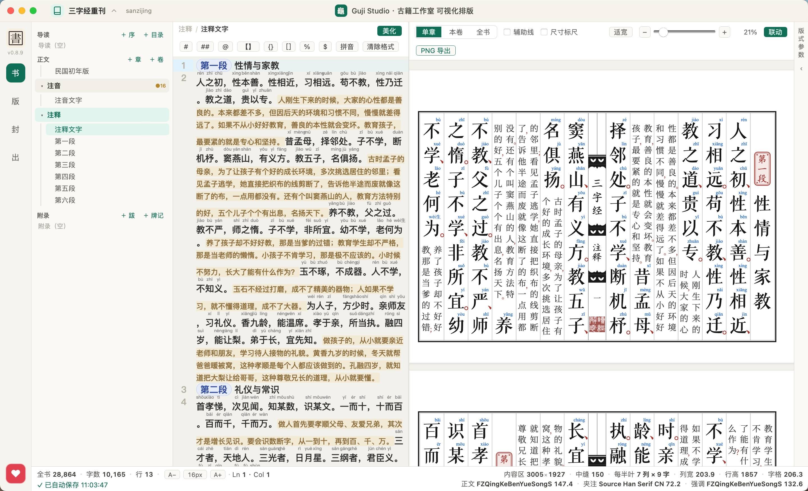
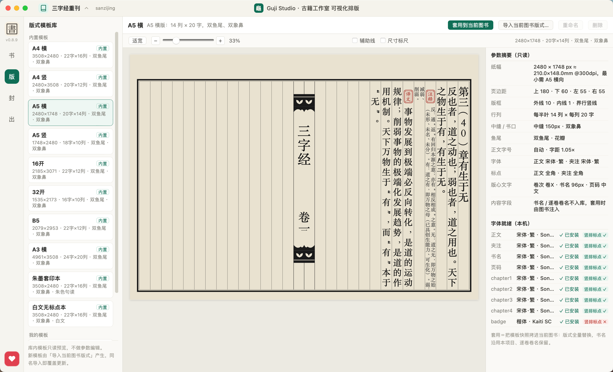
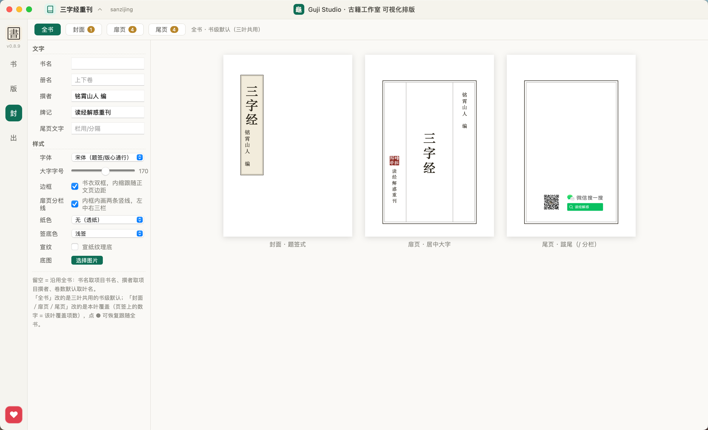
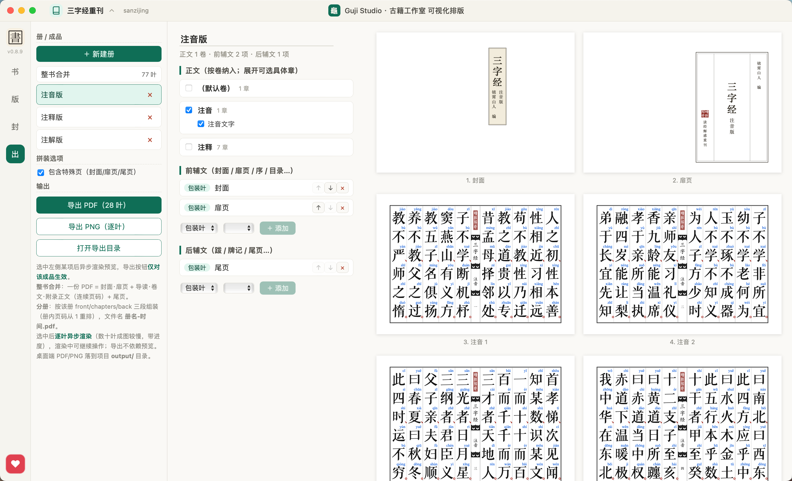
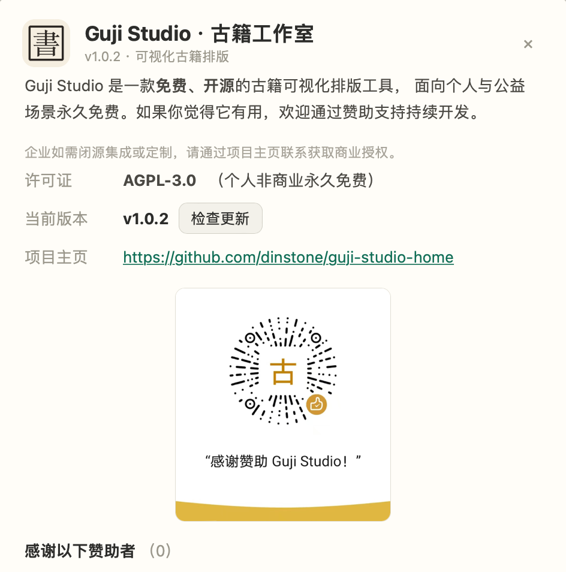

# GujiStudio · 古籍工作室

一款面向古籍整理与复刻的**桌面排版工具**：以现代输入（简体/繁体文本 + 现代标点）为源，按传统刻本的版式规范，输出竖排、句读圈点、带封页与牌记的古籍页面，并导出为 SVG / PDF。

> 设计目标：让整理者专注于「文字内容」与「版式参数」，把断句、圈点、版心、边框、封面这些刻本要素交给引擎自动完成——同一份源文本，可在「现代整理本」与「影刻本」之间一键切换。

---

## 这是什么

GujiStudio 把「古籍排版」拆成两块，让你只管内容、引擎管版式：

- **源文本永远是现代标点**：你照常写 `。，；：！？`，断句圈点是**渲染期**映射，不污染源文件——今天排句读本、明天排整理本，同一份源切一下即可。
- **版式参数化**：纸张、版框、行列、中缝、鱼尾、字号、字体全部可调，预设模板一键套用；同一套参数还能在「现代整理本」与「影刻本」之间切换。

---

## 核心特性

- **竖排古籍版式引擎**：纯 TypeScript 实现、无 DOM 依赖的排版内核，从「版式模板 + 文本」算出页码与坐标，再渲染为合法 SVG（可直接光栅化导出）。
- **句读圈点**：现代标点 `. ， ； ： ！ ？` 经渲染期映射为古籍形态——`、`（读点，矢量自绘的「蝌蚪点」、直径可调）+ `○`（句圈，矢量自绘、可控直径与线宽）。二者均不依赖字体字形、与「悬空」同路、不占字格，可染朱；源文件始终保留现代标点，切换无损。
- **标点模式四选一**：正文 / 夹注标点各支持 `全角占格 / 悬空小字 / 句读圈点 / 白文不渲染`，并可在预览器中 `Ctrl/⌘ + 滚轮` 捏合缩放、± 按钮步进。
- **册·卷·章三层结构**：
  - **册** = 独立装订单元（可各自拥有封面 / 扉页 / 版式 / 尾页）；
  - **卷** = 章的有序分组：在 `setting.json` 中以卷对象持有若干章引用（落盘为章 id 数组），决定分卷与卷内顺序；
  - **章** = 文章池中的单篇，按引用组装进册。
  - 册支持「前辅文 / 正文 / 后辅文」有序分组编辑（封面、扉页、序、目录、跋、牌记可勾选编排）。
- **特殊页**：封面、扉页、尾页（牌记）独立参数，跟随正文页边距双框；目录支持「派生 / 手动」两模式——默认由卷文自动派生（只读、不落盘、随源文实时更新），也可切手动模式直接在 `guide/目录.txt` 中撰写自定义目录。
- **模板库与版式参数**：模板库由 Go 后端统一持有，内置预设随版本播种、不可改名删除，用户模板由「当前图书版式导入」产生、可改名删除；模板是「整书版式快照」，套用即整体替换当前书。版式参数采用「书级默认 + 单元 / 卷 / 册 / 包装叶各级差异覆盖」——只存差异字段，书级改动自动同步。
- **预览与导出**：单章 / 本卷 / 全书合订三种预览范围；导出每册一份 PDF，导出处走 SVG → Image 光栅化，错误信息带叶序 + 叶标签。

---

## 界面一览

### 版式模板库

内置 A3 横 / A4 横 / A5 横 / 16 开 / 32 开 / B5（均为横版筒子叶开本）/ 朱墨套印本 / 白文无标点本等预设；选中任一模板，右侧即时列出纸张、页边距、版框、行列、中缝、鱼尾、字号与字体等全部参数，可一键套用到当前图书。

### 封面 · 扉页 · 尾页

封面（题签式）、扉页（居中大字）、尾页（牌记 / 分栏）三页各有独立参数——字体、字号、边框、纸色、签底色、底图，预览随输入即时更新。

### 出版导出

册按「前辅文 / 正文 / 后辅文」有序编排，可勾选是否包含特殊页；右侧预览即最终产物，逐叶可核对（图中为注音版），支持导出 PDF（每册一份）与逐叶 PNG。

### 关于与赞助

应用内可以查看许可、版本检查、项目主页与赞助方式。

---

## 使用手册

想上手排版？请看 **[使用手册](./UserManual.md)**——从安装、三个核心概念（册·卷·章 / 句读圈点 / 版式模板），到界面导览、五步上手、特殊页、预览导出与常见问题，都有图文说明。

---

## 下载安装

GujiStudio 是**桌面应用**，现已发布**正式版 v1.0.2**，请从本仓库的发布页获取安装包：

- **最新版本（Releases）**：[dinstone/guji-studio-home/releases/latest](https://github.com/dinstone/guji-studio-home/releases/latest) —— 自动跳转到最新发布，下载适用于你平台（Windows / macOS 等，以发布页为准）的安装包即可。
- 版本会持续迭代，建议偶尔回到上面的发布页查看是否有新版本。

---

## 许可

Copyright (C) 2026 dinstone &lt;dinstone@163.com&gt;

本项目以 **[GNU Affero 通用公共许可证第 3 版](./LICENSE)（AGPL-3.0）** 发布。你可以自由使用、修改与分发，但须遵守其条款。

与 GPL-3.0 的关键差异在于**第 13 条（Remote Network Interaction）**：若你修改本项目并通过网络向用户提供其功能（例如部署为在线服务），必须向这些用户提供对应的完整源代码。**分发桌面端 / 安装包等常规分发行为则不触发该条，与 GPL-3.0 义务相同。**

完整条款见 [./LICENSE](./LICENSE)；若需以其他条款（如商业许可）使用，请联系版权持有人。
